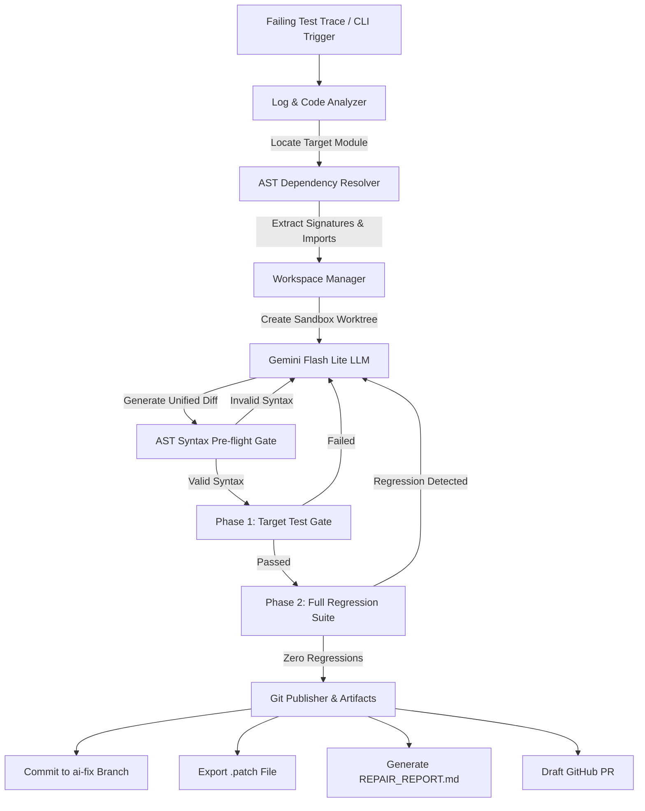

# Autonomous Software Repair Agent

[](https://github.com/Abhilash-baratam/autonomous-repair-agent/actions)
[](https://www.python.org/)
[](https://opensource.org/licenses/MIT)

An end-to-end autonomous debugging and programmatic patching engine built with **Python**, **LangChain**, and **Google Gemini Flash Lite**. 

The agent operates directly on Git repositories: isolating experimental fixes inside ephemeral Git worktrees, analyzing traceback frames, parsing cross-module dependencies via Abstract Syntax Trees (AST), enforcing dual-phase verification gates, and exporting verified patches alongside executive audit logs.

---

## 🏛️ System Architecture



---

## 🚀 Key Features

* **🛡️ Sandboxed Workspace Isolation:** Utilizes isolated Git worktrees (`git worktree`) to test patches in parallel scratch directories. The main codebase is never modified until all verification gates clear.
* **🔍 Trace Analysis & Fault Localization:** Identifies root cause source files and offending line numbers from raw stack traces using structured AST and regex analyzers.
* **🌳 Cross-Module Dependency Resolution:** Analyzes Python ASTs to resolve imported symbols and function signatures across the repository, ensuring the model understands inter-module contracts.
* **⚡ AST Syntax Pre-Flight Validation:** Inspects proposed patches using Python's native AST compiler to reject malformed syntax prior to running tests, saving computation time and test latency.
* **🚦 Dual-Phase Verification Gate:**
  * **Phase 1 (Target Gate):** Confirms the failing unit test transitions from `FAIL` to `PASS`.
  * **Phase 2 (Regression Gate):** Executes the full repository test suite to guarantee zero unintended side effects or regressions.
* **📋 Audit Logs & Delivery:** Commits verified changes to dedicated `ai-fix/*` branches, exports `.patch` unified diff artifacts, generates Markdown audit reports (`REPAIR_REPORT.md`), and prepares PR submissions via the GitHub CLI.

---

## 📂 Repository Structure

```text
autonomous-repair-agent/
├── .github/workflows/
│   └── repair.yml            # CI/CD autonomous self-healing test workflow
├── agent/
│   ├── analyzer.py            # Traceback & stack frame parser
│   ├── ast_validator.py       # Pre-flight syntax validation via AST
│   ├── dependency_resolver.py # Cross-module AST import extractor
│   └── repair_loop.py         # Autonomous iterative repair engine
├── execution_runtime/
│   ├── git_publisher.py       # PR packaging & Markdown audit reporter
│   ├── test_executor.py       # Isolated test runner subprocess wrapper
│   └── workspace.py           # Ephemeral Git worktree sandbox manager
├── cli.py                     # Universal command-line interface entrypoint
├── setup.py                   # Package configuration (repair-agent CLI)
├── Dockerfile                 # Sandboxed container definition
├── requirements.txt           # Project dependencies
└── README.md                  # System documentation
```

---

## 🛠️ Installation & Setup

### 1. Clone the Repository
```bash
git clone [https://github.com/Abhilash-baratam/autonomous-repair-agent.git](https://github.com/Abhilash-baratam/autonomous-repair-agent.git)
cd autonomous-repair-agent
```

### 2. Set Up Virtual Environment
```bash
python -m venv venv
# On Windows:
venv\Scripts\activate
# On Linux/macOS:
source venv/bin/activate
```

### 3. Install Dependencies
```bash
pip install -r requirements.txt
pip install -e .
```

### 4. Configure API Keys
Create a `.env` file in the root directory:
```env
GEMINI_API_KEY=your_gemini_api_key_here
```

---

## 💻 CLI Usage

You can run the repair agent on any local Git repository:

```bash
repair-agent \
  --repo ./path/to/target/repo \
  --target-test "pytest tests/test_billing.py" \
  --regression-test "pytest" \
  --max-retries 3
```

### CLI Arguments
| Flag | Description | Default |
|---|---|---|
| `--repo` | Path to target Git repository | *Required* |
| `--target-test` | Command to run the failing target test | *Required* |
| `--regression-test` | Command to run the full regression test suite | `pytest -q` |
| `--max-retries` | Max iterative patch attempts | `3` |
| `--model` | Gemini model identifier | `gemini-flash-lite-latest` |

---

## 🐳 Docker Deployment

To run the repair agent inside an isolated Docker container:

```bash
# Build the Docker image
docker build -t autonomous-repair-agent .

# Run on a mounted repository
docker run --rm \
  -v $(pwd)/my_project:/repo \
  -e GEMINI_API_KEY="your_key" \
  autonomous-repair-agent --repo /repo --target-test "pytest tests/test_core.py"
```

---

## 📄 Example Audit Report (`REPAIR_REPORT.md`)

Each successful repair run generates an audit artifact inside `exported_patches/`:

```markdown
# Autonomous Repair Engine - Execution Audit

**Bug ID:** `INV-DISCOUNT-REG-01-1301bdec`  
**Target Module:** `billing.py`  
**Status:** `VERIFIED_RESOLVED`  
**Repair Iterations:** `1`  

---

## 1. Verification Gate Summary
- **Phase 1 (Target Test):** Passed via `pytest test_billing.py`
- **Phase 2 (Regression Suite):** Zero regressions detected across full test suite
- **AST Pre-flight:** Syntax analysis validated cleanly

---

## 2. Generated Unified Diff
```diff
--- a/billing.py
+++ b/billing.py
@@ -3,3 +3,3 @@
     discount = compute_discount(subtotal, discount_percent)
-    taxable_amount = subtotal + discount
+    taxable_amount = subtotal - discount
     tax = compute_tax(taxable_amount, tax_rate)
```
```

---

## 📜 License
Distributed under the MIT License. See `LICENSE` for more information.
